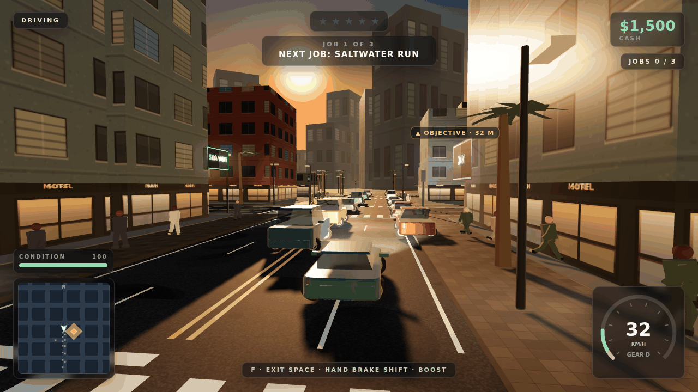
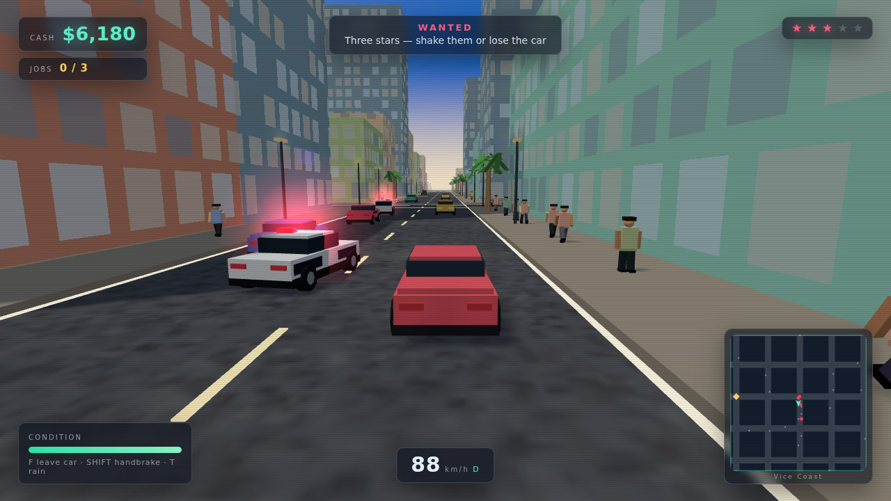
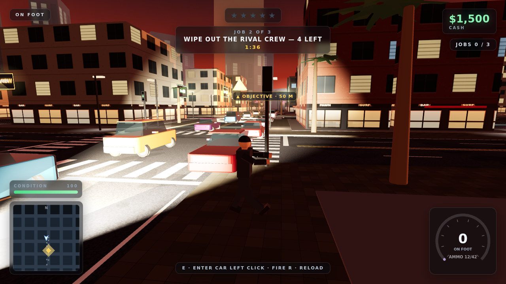
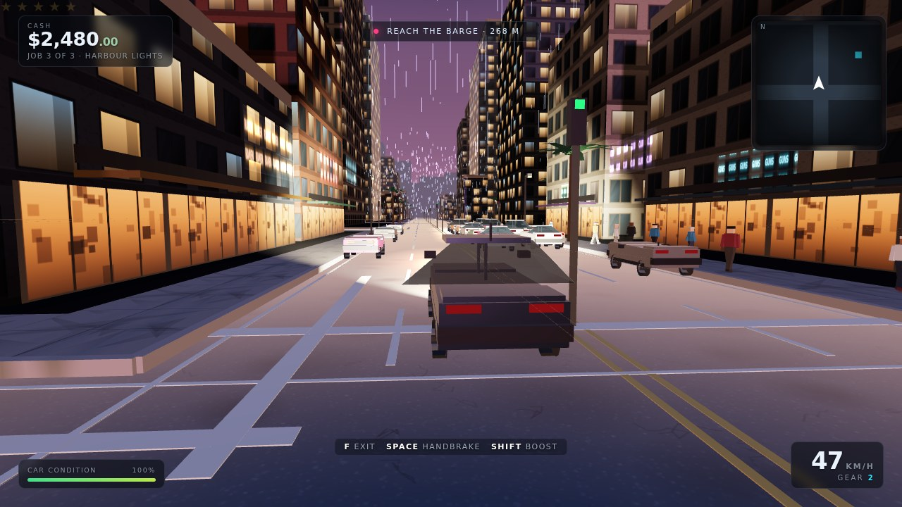

# Neon City — Saltwater Vice

[](https://make.fun/bounty/gta6-01)
[](https://github.com/Topan998/neon-city-gta6)
[](https://make.fun/bounty/gta6-01)

An open-world crime game that runs in a desktop browser straight from its own files: no build step, no package install, no network calls once the page is open. Three.js is vendored, the world is generated in code, and every model is low-poly geometry built at load time.

You are a wheelman in Neon City, a grid of blocks, storefronts and neon on a strip of coast that turns from golden hour to a lit-up night. Dessy has work for you. Marco's crew has other ideas. The police have a running total of your mistakes.

## What is in the game

**The city.** Eight by eight blocks of streets, pavements, crossings, palms and lit storefronts, ending at a beach and open water. A shader sky moves through the day, so the same corner reads differently at noon and after dark. Buildings, kerbs and street furniture are solid: you can hit them, and hitting them costs you.

**Traffic and pedestrians.** Cars run the grid on the same handling model the player uses, queuing at corners and shoving through gaps. Pedestrians walk the pavements, and they scatter when a car comes at them or a shot goes off.

**Stealable cars.** Any car in the street is a car you can take: walk up to it, press `E`, and it is yours. Every car carries damage — dents, smoke, a condition bar — and the same physics apply whether it is a parked sedan or a police cruiser.

**Wanted level and police.** Crimes add heat; heat turns into up to five stars. Cruisers spawn and give chase, and at three stars officers get out on foot with pistols. Break line of sight and keep it broken: the heat bleeds away star by star until the street goes quiet again.

**Three story missions.** *Saltwater Run* (collect a case, deliver it to the pier before dark, $1,500), *Bad Business* (Marco's crew took the corner — take it back, $2,600) and *Harbour Lights* (get a loaded car onto the barge before the tide, $4,200). Each is a chain of timed objectives with radio dialogue, an on-screen waypoint and a payout.

**Taxi fares and stunt jumps.** Between jobs the city still pays: pick up a fare at the green marker and beat the clock to the drop-off for $120–$340, or hit one of eight stunt rings at speed in a car for $350–$600. Both keep their own progress.

**HUD and minimap.** Mode label, wanted stars, current job and objective with a live distance countdown, cash and jobs completed, condition/vitals bar, speedometer with gear, control prompts, and a rotating minimap that draws the street grid, the player, police blips, the objective diamond and activity markers.

**Save.** Cash, mission progress, fares, jumps and your last position are written to `localStorage` every time the money changes and restored on the next load. Wipe the site data to start over.

## Controls

| Input | On foot | In a car |
| --- | --- | --- |
| `W` `A` `S` `D` / arrows | Walk | Throttle, steer, reverse |
| Mouse | Look (click to lock the pointer) | Look around |
| `Shift` | Sprint | Boost |
| `Space` | — | Handbrake / drift |
| `E` | Enter the nearest car | — |
| `F` | — | Exit the car |
| Left click | Fire | — |
| `R` | Reload | Reload |
| `M` | Mute / unmute | Mute / unmute |
| `Esc` | Pause | Pause |
| `Enter` / `Space` | Start the game | Start the game |

## Running it

Needs Node.js 22.18 or newer and a desktop browser. There is nothing to install.

```sh
node serve.ts
```

Then open <http://localhost:8080>. The server serves `game/` only, with the MIME types a browser game needs; pass `--port 3000` if 8080 is taken.

## Screenshots



*Saltwater Run, first job of three: traffic ahead, pedestrians on the pavement, the objective 32 metres out.*



*Three stars and a cruiser in the mirror — the minimap shows the police blips closing in.*



*Bad Business: on foot with a pistol, four of Marco's crew left and 1:36 on the clock.*



*After dark the same street turns neon; the HUD keeps the route and the cash in view.*

## Layout

```
game/               the game itself: index.html, src/*.js, vendor/three.min.js
serve.ts            zero-dependency static server for game/
main.ts             hand-in: stages game/ and screenshots/, writes dossier.json
vendor/             the make.fun dossier builder
screenshots/        four renders of the game
shots.json          which ?shot= scene each screenshot was taken from
```

## The bounty

This entry was built for **make.fun bounty gta6-01 — "Make GTA 6"**: the most complete open-world crime game you can fit in a browser, played offline from its own files.

<https://make.fun/bounty/gta6-01>
